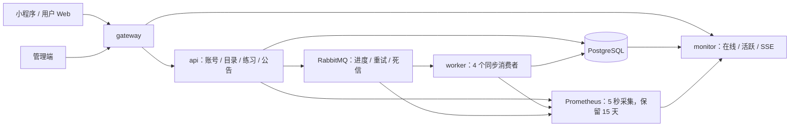

# QandA 后端模块与运行边界

应用制品与合同保持 `1.0.0`，接口前缀为 `/api/v1`。当前使用 Kotlin 2.2.21、JDK 21、Spring Boot 3.5.16、MyBatis-Plus 3.5.18、PostgreSQL 17。同一 JAR 按角色运行核心 API、后台消费者和监控三个进程。

完整数据库关系、字段和索引见[数据库设计](database-design.md)，同步状态、指标和运行操作见[同步与监控](sync-monitoring.md)，本轮实际证据见[验收记录](sync-monitoring-verification.md)。

## 模块与数据归属

| 业务模块 | 代码位置 | 数据与公开能力 |
| --- | --- | --- |
| 学生账号 | `identity` | 注册、登录、会话、资料；`identity.api.AccountDirectory` 提供账号查询，`Sessions` 统一身份检查 |
| 管理员 | `admin` | 管理员身份、权限与安全规则；复用账号模块的会话校验 |
| 学院专业与课程 | `catalog` | 学院、专业、课程、课程单独开放；`catalog.api.CatalogDirectory` 提供分类引用与可用性 |
| 题库内容 | `content` | 题库、范围、章节、修订、选项、附件、发布导入；`content.api.ContentLibrary` 提供访问校验、修订快照与组卷数据 |
| 练习 | `practice` | 组卷、作答、判题、自评、正式成绩；调用同步模块维护写入权 |
| 数据同步 | `sync.api`、`application.ProgressCommands` | 写入权、确认序号、持久消息、进度命令与回执；应用服务协调账号、练习与队列事务 |
| 学习记录 | `learning`、`discovery` | 收藏、错题、个人课程、历史及学习摘要；`learning.api.ReadContracts` 是跨模块的只读 SQL 合同 |
| 公告 | `announcements` | 公告内容、客户端及接收范围，拥有独立 Controller、Service 和查询 |
| 反馈运营 | `operations` | 题目纠错、缺课需求、处理结果与内容概览 |
| 监控 | `monitoring` | 前台心跳、活跃投影、在线明细、趋势排行、队列与接口健康、SSE |
| 平台支撑 | `platform` | 事务命令、幂等回执、审计、HTTP、安全、文件、邮件和业务事件 |

实体和 Mapper 属于模块内部。跨模块服务调用使用公开接口或明确的查询合同，不注入其他业务模块的 Mapper，不返回其持久化实体。共享展示查询 DTO 位于 `platform.queries`。单表操作采用 MyBatis-Plus Java API，复杂查询采用 XML；同步事务使用 JdbcTemplate 执行显式锁和状态转换。

`ModuleBoundaryTest` 检查跨模块 Mapper/实体引用、服务循环依赖、XML 引用能否解析以及跨模块 SQL 是否指向公开合同。业务读视图是允许的跨表查询入口，表之间的外键继续保护数据关系。

## 运行拓扑

箭头表示数据依赖。Prometheus 主动抓取各进程 Actuator 和 RabbitMQ 指标；监控进程统一查询、缓存，再向浏览器分发。管理端的 SSE 请求经 gateway 路由至 monitor；死信恢复仍由核心 API 的写命令入口执行。

| 进程 | 执行工作 | 默认数据库连接数 | 资源约束 |
| --- | --- | --- | --- |
| api | 核心 HTTP、进度登记与发布、交卷及接管 | 8 | Compose 内存上限 768 MiB |
| worker | RabbitMQ 消费、活跃事件投影、邮件投递 | 6 | 768 MiB；同步 4 个消费者、预取 1；定时线程池 4 |
| monitor | 聚合只读查询、指标采样、SSE | 2 | 512 MiB；SQL 超时 3 秒；64 条 SSE 连接上限 |

三个进程拥有独立连接池。monitor 连接通过 `SET ROLE qanda_monitor` 限定常规 SQL 权限，业务查询只读，认证可更新会话最近访问时间，错误处理可追加审计；统计投影事务通过 `SET LOCAL ROLE qanda_activity_writer` 限定写入范围。当前使用共享数据库登录凭据后切换数据库角色，属于应用内权限约束；独立低权限登录凭据是进一步部署隔离的工作。

公告是同步查询模块，查询超时 3 秒。邮件有独立出站表、租约与错误处理，活跃统计有独立事件表和批次处理；两者使用各自定时任务，同步消息使用 RabbitMQ 监听器线程。后台任务共享 worker 进程，进程级故障仍会同时影响这些后台任务。

## 事务和一致性

- 业务写命令在同一 PostgreSQL 事务中保存业务变更、幂等回执、成功审计和业务事件。登录失败、验证码失败等原有独立事务继续保存防护信息。
- 进度接收先鉴权、检查写入权并登记命令，再发布消息；RabbitMQ 发布确认后返回 `202`。消息正文保存在持久队列，数据库命令表保存摘要与处理元数据。
- 消费端重新检查身份、写入凭证、业务版本和本地序号；进度、命令完成状态及回执同事务提交，随后 ACK。重复投递读取同一回执。
- 交卷、取消、交出写入权会锁定练习并检查未完成进度。新设备等待旧端最后一批进度落库。
- 登录与学习事务只写 `domain_event_outbox`，后台按事件发生时间更新每日活跃，延迟处理仍归入正确的北京时间日期。
- 公告、活跃查询和监控图表请求各自失败，不进入答题事务。客户端的已下载练习和持久草稿支持故障期间续答。

## 资料、内容和历史

用户可自由修改学院、专业、当前年级；选择专业时由专业推导学院，数据库约束两种归属互斥。年级由设置值和所属学年计算，每年北京时间 9 月 1 日递增，最高为已毕业。

登录用户的目录、搜索、单题及新练习统一使用资料匹配、全校开放和课程单独开放范围；游客浏览已发布内容。资料变化不改变历史练习归属。

题目稳定 ID 与不可变内容修订分离。阅读小题引用同题库的材料，练习固定小题及材料修订。修订、选项、附件、正式结果及审计由数据库触发器保护；已发放练习的题目、题序和材料绑定同样固定。内容停用、题库下架及归档保留历史引用。

练习按独立 ID 保存，可以并行保留多场练习。每场练习的业务版本、内容修订、写入凭证及确认序号分别表达。正式结果由服务端判题；简答自评单独记录，结果计数有非负和范围约束。

## 故障边界

| 故障 | 当前行为 |
| --- | --- |
| 公告查询失败 | 公告返回错误；其他业务使用各自请求 |
| monitor 退出或采集失败 | 页面保留最后成功数据并标记过期；API 和 worker 继续运行 |
| worker 停止 | 已确认消息留在 RabbitMQ，客户端保留原命令与草稿；正式交卷等待进度完成 |
| RabbitMQ 不可用 | 新同步返回可重试错误，原幂等键保持；账号、目录及公告不依赖消息发布 |
| 目录不可用 | 创建新练习受影响，完整下载的练习继续本地作答 |
| PostgreSQL 或核心进程退出 | 依赖它的核心功能受影响；客户端继续保留草稿 |

当前仍共享 PostgreSQL，核心模块仍在同一 api 进程，后台任务仍在同一 worker 进程。独立进程、查询预算与模块接口限制影响范围；数据库停机和共享进程退出是明确的共同故障边界。

## 接口与安全

学生和管理员分别认证，服务端保存令牌摘要。请求使用独立追踪号，写命令使用 UUID 幂等键，更新使用业务版本。JSON 校验拒绝重复键、未知字段和无效 UTF-8。查询与接口预算按当前进程执行。

Actuator 的健康与 Prometheus 端点位于内部端口，RabbitMQ、Prometheus 和监控进程不直接对外暴露。gateway 提供统一业务入口。完整合同由 Controller/DTO 导出；模块拆分保留已有 operationId，新操作同步到 Postman 和[接口台账](miniapp-api-integration.md)。
