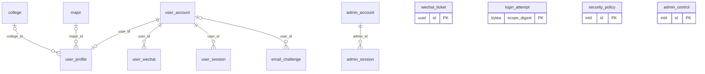
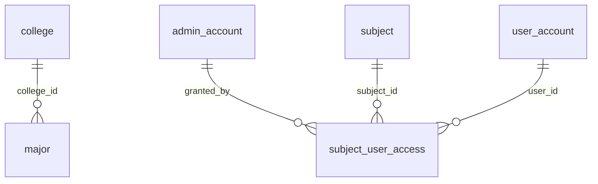
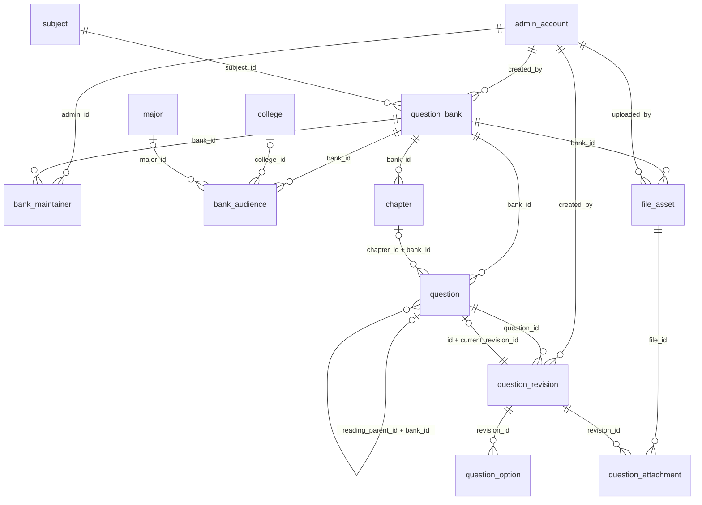
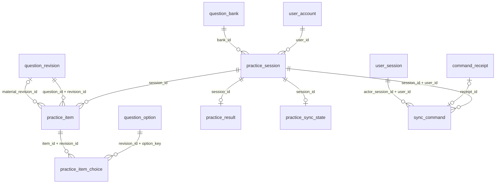
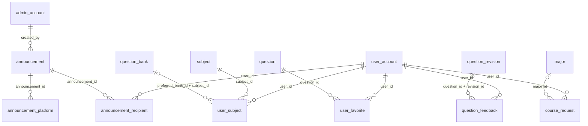
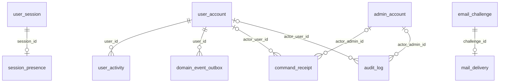

# QandA 数据库设计

本文件依据 v1.0 初始化 DDL 和隔离 PostgreSQL 实际导出的元数据整理。当前为 **43 张表、63 项外键**；复合外键按一项关系计算。字段、约束和索引以 `schema.sql` 为准；管理员角色约束已按当前 DDL 更新，待下一轮隔离数据库导出复核。

数据库保存稳定用户、内容修订和业务事实；RabbitMQ 保存等待处理的进度消息。模块归属见[后端架构](backend-architecture.md)，消息与回执协议见[同步与监控](sync-monitoring.md)。

## 关系概览

学生账号是个人资料、登录会话、学习记录和练习的共同归属。学院包含专业，资料选择专业后由专业推导学院；用户可以随时切换资料。课程包含题库，课程单独开放覆盖后续发布题库，题库范围按当前资料计算。

题目稳定身份与不可变修订分开。练习固定题目修订和阅读材料修订，正式结果属于该场练习；停用内容保留外键和已有历史。错题来自练习结果和最新掌握状态查询，当前没有另一张重复维护的错题事实表。

写入设备、凭证和确认序号在 `practice_sync_state`，业务进度和业务版本在 `practice_session`。同步命令关联练习、提交者会话和最终回执；两组复合外键确保会话和练习属于同一用户。一场练习可以有多个历史命令，最多一个未完成命令。

前台在线状态关联登录会话，活跃记录关联用户。业务事件在业务事务中写出，后台按发生日期投影；监控查询通过公开只读视图取得当前资料和正式成绩。

## ER 图

以下按外键所在子表分组，每条物理外键展示一次。跨组实体在相应图中重复出现，仍表示同一张表。线端 `||` 为必需的一个，`|o` 为可选的一个，`o{` 为零到多个，`o|` 为零或一个。复合外键在关系文字中列出多个字段。

### 账号与认证



### 学院专业、课程与开放



### 题库、题目及内容修订



### 练习与数据同步



### 学习记录、反馈与公告



### 活跃、事件与平台支撑



## 一致性与生命周期

| 规则 | 数据库保护 |
| --- | --- |
| 资料院系 | `user_profile.college_id` 与 `major_id` 互斥；选择专业由专业外键推导学院 |
| 开放范围 | `bank_audience` 保留院、专业与年级条件；`subject_user_access` 以课程、用户唯一 |
| 内容修订 | 稳定题目与当前修订互相引用，延迟外键允许同事务创建；修订、选项及附件禁止事后更新或删除 |
| 章节归属 | 题目章节、题库复合外键保证同一题库 |
| 阅读关系 | 材料与小题同题库；触发器校验材料类型、组标记与父子归属 |
| 练习快照 | 题目修订与题目匹配，材料修订属于同一阅读父题；已发放的题序和修订绑定不可修改 |
| 正式结果 | 每场练习唯一；题数、已答数、正确错误和未答数非负且满足总数范围；结果不可修改或删除 |
| 命令与回执 | 命令主键是幂等键；练习／写入凭证／本地序号唯一；COMMITTED 必须有回执；终态必须有完成时间 |
| 单写入屏障 | 部分唯一索引约束每场练习的 ACCEPTING、QUEUED、RETRYING、DEAD_LETTER 最多一条 |
| 身份归属 | 同步命令的练习与登录会话分别通过包含 user_id 的复合外键关联 |
| 在线与活跃 | session_presence 按会话唯一；user_activity 按用户、客户端、自然日唯一 |
| 事件投影 | FOR UPDATE SKIP LOCKED 领取，投影与 processed_at 同事务更新，重复日期使用 upsert |
| 审计 | audit_log 追加保存，更新和删除被触发器阻止 |

`admin_control`、`security_policy`、`login_attempt`、`wechat_ticket` 的作用域是整个系统或账号创建前阶段，因此没有用户外键。它们通过初始化状态、防护摘要、验证码或注册消费流程与业务衔接。

## 只读查询合同与数据库权限

| 合同 | 提供的信息 |
| --- | --- |
| `monitoring_student` | 用户当前账号、院系及计算后的年级 |
| `monitoring_learning` | 已提交正式练习、客户端、题数及学习时长 |
| `monitoring_session` | 学生会话状态与账号有效性 |
| `monitoring_online_at(sample_time)` | 同一采样时刻内满足 120 秒心跳及身份条件的会话 |
| `monitoring_sync_completion` | 已提交唯一同步命令的接收和完成时间 |
| `monitoring_jobs` | 待处理活跃事件与邮件计数 |
| `learning.api.ReadContracts` | 错题事实的公开 SQL 片段，供目录和学习摘要共用 |

`qanda_monitor` 可以读取这些视图与必要的身份数据、触达会话最近访问时间、追加失败审计；它没有练习、题目或统计投影的修改权。`qanda_activity_writer` 只写活跃聚合与事件完成标记。授权定义在 `monitoring-permissions.sql`。

当前进程使用数据库连接初始化语句切换角色，数据库登录凭据仍共享；这是应用内权限分工。部署时独立登录凭据和高可用基础设施需要单独配置。

## 字段、约束与索引字典

时间戳使用 `timestamptz`，连接时区为 UTC，自然日按 `Asia/Shanghai` 计算。UUID 由业务生成；表内 `version`、`content_version`、`revision_number`、`client_sequence` 和 `credential_version` 各有用途，不等同于应用 v1.0。

下列字段的空值、默认值、长度、检查约束与索引取自实际 PostgreSQL 元数据。主键和唯一约束会自动建立索引，显式索引主要服务于活动窗口、未完成命令、已完成命令和待投影事件查询。


### 账号与认证

#### `user_account`

模块：`identity`。学生稳定身份、账号标识、凭据和状态。

| 字段 | PostgreSQL 类型 | 可空 | 默认值 | 含义 |
| --- | --- | --- | --- | --- |
| `id` | `uuid` | 否 | — | 稳定主键 |
| `account_code` | `varchar(12)` | 否 | — | 展示用账号标识 |
| `nickname` | `varchar(40)` | 否 | — | 学生昵称 |
| `avatar` | `text` | 是 | — | 账户头像，JPEG/PNG data URI；最多 64 KiB、256×256 像素 |
| `email` | `varchar(254)` | 是 | — | 邮箱地址 |
| `email_key` | `varchar(254)` | 是 | — | 规范化邮箱匹配键 |
| `password_hash` | `varchar(256)` | 是 | — | 密码单向散列 |
| `status` | `varchar(12)` | 否 | `'ACTIVE'::character varying` | 业务状态，取值见 CHECK |
| `version` | `int8` | 否 | `1` | 业务并发版本 |
| `credential_version` | `int8` | 否 | `1` | 凭据版本，使旧会话失效 |
| `created_at` | `timestamptz` | 否 | `now()` | 创建时间 |
| `updated_at` | `timestamptz` | 否 | `now()` | 更新时间 |

约束：

```text
user_account_account_code_key: UNIQUE (account_code)
user_account_avatar_check: CHECK (avatar IS NULL OR (char_length(avatar) BETWEEN 1 AND 87407 AND avatar ~ '^data:image/(jpeg|png);base64,'))
user_account_check: CHECK (((email IS NULL) = (email_key IS NULL)))
user_account_credential_version_check: CHECK ((credential_version > 0))
user_account_email_key_check: CHECK (((email_key IS NULL) OR ((email_key)::text = lower((email_key)::text))))
user_account_email_key_key: UNIQUE (email_key)
user_account_pkey: PRIMARY KEY (id)
user_account_status_check: CHECK (((status)::text = ANY ((ARRAY['ACTIVE'::character varying, 'DISABLED'::character varying])::text[])))
user_account_version_check: CHECK ((version > 0))
```

索引：

```sql
CREATE UNIQUE INDEX user_account_account_code_key ON public.user_account USING btree (account_code);
CREATE UNIQUE INDEX user_account_email_key_key ON public.user_account USING btree (email_key);
CREATE UNIQUE INDEX user_account_pkey ON public.user_account USING btree (id);
```

#### `user_profile`

模块：`identity`。用户主动选择的院系与基准年级，按学年计算当前年级。

| 字段 | PostgreSQL 类型 | 可空 | 默认值 | 含义 |
| --- | --- | --- | --- | --- |
| `user_id` | `uuid` | 否 | — | 学生用户外键 |
| `college_id` | `uuid` | 是 | — | 学院外键 |
| `major_id` | `uuid` | 是 | — | 专业外键 |
| `grade` | `int4` | 是 | — | 设置时年级或范围年级，1～5 对应大一至已毕业 |
| `grade_academic_year` | `int4` | 是 | — | 设置年级所属学年，9 月 1 日递增 |

约束：

```text
user_profile_check: CHECK (((grade IS NULL) = (grade_academic_year IS NULL)))
user_profile_check1: CHECK (((major_id IS NULL) OR (college_id IS NULL)))
user_profile_college_id_fkey: FOREIGN KEY (college_id) REFERENCES college(id)
user_profile_grade_academic_year_check: CHECK (((grade_academic_year >= 1900) AND (grade_academic_year <= 2200)))
user_profile_grade_check: CHECK (((grade >= 1) AND (grade <= 5)))
user_profile_major_id_fkey: FOREIGN KEY (major_id) REFERENCES major(id)
user_profile_pkey: PRIMARY KEY (user_id)
user_profile_user_id_fkey: FOREIGN KEY (user_id) REFERENCES user_account(id)
```

索引：

```sql
CREATE INDEX user_profile_college_idx ON public.user_profile USING btree (college_id);
CREATE INDEX user_profile_major_idx ON public.user_profile USING btree (major_id);
CREATE UNIQUE INDEX user_profile_pkey ON public.user_profile USING btree (user_id);
```

#### `user_wechat`

模块：`identity`。已绑定微信身份。

| 字段 | PostgreSQL 类型 | 可空 | 默认值 | 含义 |
| --- | --- | --- | --- | --- |
| `id` | `uuid` | 否 | — | 稳定主键 |
| `user_id` | `uuid` | 否 | — | 学生用户外键 |
| `app_id` | `varchar(64)` | 否 | — | 微信应用标识 |
| `open_id` | `varchar(128)` | 否 | — | 应用内微信身份 |
| `union_id` | `varchar(128)` | 是 | — | 微信跨应用身份（可空） |
| `created_at` | `timestamptz` | 否 | `now()` | 创建时间 |

约束：

```text
user_wechat_app_id_open_id_key: UNIQUE (app_id, open_id)
user_wechat_pkey: PRIMARY KEY (id)
user_wechat_user_id_app_id_key: UNIQUE (user_id, app_id)
user_wechat_user_id_fkey: FOREIGN KEY (user_id) REFERENCES user_account(id)
```

索引：

```sql
CREATE UNIQUE INDEX user_wechat_app_id_open_id_key ON public.user_wechat USING btree (app_id, open_id);
CREATE UNIQUE INDEX user_wechat_pkey ON public.user_wechat USING btree (id);
CREATE UNIQUE INDEX user_wechat_user_id_app_id_key ON public.user_wechat USING btree (user_id, app_id);
```

#### `user_session`

模块：`identity`。学生登录令牌摘要、有效期与凭据版本。

| 字段 | PostgreSQL 类型 | 可空 | 默认值 | 含义 |
| --- | --- | --- | --- | --- |
| `id` | `uuid` | 否 | — | 稳定主键 |
| `user_id` | `uuid` | 否 | — | 学生用户外键 |
| `token_digest` | `bytea` | 否 | — | 令牌摘要 |
| `credential_version` | `int8` | 否 | — | 凭据版本，使旧会话失效 |
| `client_type` | `varchar(16)` | 否 | — | 请求所属客户端 |
| `device_id` | `uuid` | 否 | — | 客户端设备标识 |
| `issued_at` | `timestamptz` | 否 | — | 会话签发时间 |
| `expires_at` | `timestamptz` | 否 | — | 过期时间 |
| `last_seen_at` | `timestamptz` | 否 | — | 最近认证访问或每日活跃时间，区别于前台心跳 |
| `revoked_at` | `timestamptz` | 是 | — | 会话撤销时间 |

约束：

```text
user_session_check: CHECK ((expires_at > issued_at))
user_session_client_type_check: CHECK (((client_type)::text = ANY ((ARRAY['WEB'::character varying, 'MINI_PROGRAM'::character varying])::text[])))
user_session_id_user_id_key: UNIQUE (id, user_id)
user_session_pkey: PRIMARY KEY (id)
user_session_token_digest_check: CHECK ((octet_length(token_digest) = 32))
user_session_token_digest_key: UNIQUE (token_digest)
user_session_user_id_fkey: FOREIGN KEY (user_id) REFERENCES user_account(id)
```

索引：

```sql
CREATE INDEX user_session_account_idx ON public.user_session USING btree (user_id, issued_at DESC);
CREATE UNIQUE INDEX user_session_id_user_id_key ON public.user_session USING btree (id, user_id);
CREATE UNIQUE INDEX user_session_pkey ON public.user_session USING btree (id);
CREATE UNIQUE INDEX user_session_token_digest_key ON public.user_session USING btree (token_digest);
```

#### `email_challenge`

模块：`identity`。邮箱验证码用途、MAC、尝试次数与有效期。

| 字段 | PostgreSQL 类型 | 可空 | 默认值 | 含义 |
| --- | --- | --- | --- | --- |
| `id` | `uuid` | 否 | — | 稳定主键 |
| `user_id` | `uuid` | 是 | — | 学生用户外键 |
| `purpose` | `varchar(24)` | 否 | — | 验证码业务用途 |
| `email` | `varchar(254)` | 否 | — | 邮箱地址 |
| `email_key` | `varchar(254)` | 否 | — | 规范化邮箱匹配键 |
| `code_mac` | `bytea` | 否 | — | 验证码 MAC |
| `key_version` | `int4` | 否 | — | 加密或 MAC 密钥版本 |
| `eligible` | `bool` | 否 | — | 验证码是否满足当前业务前提 |
| `credential_version` | `int8` | 是 | — | 凭据版本，使旧会话失效 |
| `failed_attempts` | `int4` | 否 | `0` | 验证码错误尝试次数 |
| `created_at` | `timestamptz` | 否 | — | 创建时间 |
| `expires_at` | `timestamptz` | 否 | — | 过期时间 |
| `consumed_at` | `timestamptz` | 是 | — | 票据或验证码使用时间 |

约束：

```text
email_challenge_check: CHECK ((expires_at > created_at))
email_challenge_code_mac_check: CHECK ((octet_length(code_mac) = 32))
email_challenge_failed_attempts_check: CHECK (((failed_attempts >= 0) AND (failed_attempts <= 5)))
email_challenge_pkey: PRIMARY KEY (id)
email_challenge_purpose_check: CHECK (((purpose)::text = ANY ((ARRAY['REGISTER'::character varying, 'RESET_PASSWORD'::character varying, 'BIND_EMAIL'::character varying, 'CHANGE_PASSWORD'::character varying, 'CHANGE_EMAIL_OLD'::character varying, 'CHANGE_EMAIL_NEW'::character varying])::text[])))
email_challenge_user_id_fkey: FOREIGN KEY (user_id) REFERENCES user_account(id)
```

索引：

```sql
CREATE UNIQUE INDEX email_challenge_pkey ON public.email_challenge USING btree (id);
CREATE INDEX email_challenge_target_idx ON public.email_challenge USING btree (email_key, purpose, created_at DESC);
CREATE INDEX email_challenge_user_idx ON public.email_challenge USING btree (user_id);
```

#### `wechat_ticket`

模块：`identity`。账号创建前的微信注册票据。

| 字段 | PostgreSQL 类型 | 可空 | 默认值 | 含义 |
| --- | --- | --- | --- | --- |
| `id` | `uuid` | 否 | — | 稳定主键 |
| `token_digest` | `bytea` | 否 | — | 令牌摘要 |
| `app_id` | `varchar(64)` | 否 | — | 微信应用标识 |
| `open_id` | `varchar(128)` | 否 | — | 应用内微信身份 |
| `union_id` | `varchar(128)` | 是 | — | 微信跨应用身份（可空） |
| `expires_at` | `timestamptz` | 否 | — | 过期时间 |
| `consumed_at` | `timestamptz` | 是 | — | 票据或验证码使用时间 |

约束：

```text
wechat_ticket_pkey: PRIMARY KEY (id)
wechat_ticket_token_digest_key: UNIQUE (token_digest)
```

索引：

```sql
CREATE UNIQUE INDEX wechat_ticket_pkey ON public.wechat_ticket USING btree (id);
CREATE UNIQUE INDEX wechat_ticket_token_digest_key ON public.wechat_ticket USING btree (token_digest);
```

#### `login_attempt`

模块：`platform.security`。登录失败次数与临时锁定。

| 字段 | PostgreSQL 类型 | 可空 | 默认值 | 含义 |
| --- | --- | --- | --- | --- |
| `scope_digest` | `bytea` | 否 | — | 防护范围摘要 |
| `failures` | `int4` | 否 | `0` | 连续失败次数 |
| `blocked_until` | `timestamptz` | 是 | — | 锁定结束时间 |
| `updated_at` | `timestamptz` | 否 | `now()` | 更新时间 |

约束：

```text
login_attempt_pkey: PRIMARY KEY (scope_digest)
login_attempt_scope_digest_check: CHECK ((octet_length(scope_digest) = 32))
```

索引：

```sql
CREATE UNIQUE INDEX login_attempt_pkey ON public.login_attempt USING btree (scope_digest);
```

#### `admin_account`

模块：`admin`。管理员稳定身份、角色与凭据。

| 字段 | PostgreSQL 类型 | 可空 | 默认值 | 含义 |
| --- | --- | --- | --- | --- |
| `id` | `uuid` | 否 | — | 稳定主键 |
| `username` | `varchar(64)` | 否 | — | 管理员登录名 |
| `name` | `varchar(40)` | 否 | — | 显示名称 |
| `password_hash` | `varchar(256)` | 否 | — | 密码单向散列 |
| `role` | `varchar(20)` | 否 | — | 管理员身份，固定为 `SUPER_ADMIN` |
| `status` | `varchar(12)` | 否 | — | 业务状态，取值见 CHECK |
| `version` | `int8` | 否 | `1` | 业务并发版本 |
| `credential_version` | `int8` | 否 | `1` | 凭据版本，使旧会话失效 |
| `created_at` | `timestamptz` | 否 | `now()` | 创建时间 |
| `updated_at` | `timestamptz` | 否 | `now()` | 更新时间 |
| `last_login_at` | `timestamptz` | 是 | — | 最后登录时间 |

约束：

```text
admin_account_credential_version_check: CHECK ((credential_version > 0))
admin_account_pkey: PRIMARY KEY (id)
admin_account_role_check: CHECK (((role)::text = 'SUPER_ADMIN'::text))
admin_account_status_check: CHECK (((status)::text = ANY ((ARRAY['ACTIVE'::character varying, 'INACTIVE'::character varying])::text[])))
admin_account_username_key: UNIQUE (username)
admin_account_version_check: CHECK ((version > 0))
```

索引：

```sql
CREATE UNIQUE INDEX admin_account_pkey ON public.admin_account USING btree (id);
CREATE UNIQUE INDEX admin_account_username_key ON public.admin_account USING btree (username);
```

#### `admin_session`

模块：`admin`。管理员登录会话与空闲期限。

| 字段 | PostgreSQL 类型 | 可空 | 默认值 | 含义 |
| --- | --- | --- | --- | --- |
| `id` | `uuid` | 否 | — | 稳定主键 |
| `admin_id` | `uuid` | 否 | — | 管理员外键 |
| `token_digest` | `bytea` | 否 | — | 令牌摘要 |
| `credential_version` | `int8` | 否 | — | 凭据版本，使旧会话失效 |
| `device_id` | `uuid` | 否 | — | 客户端设备标识 |
| `issued_at` | `timestamptz` | 否 | — | 会话签发时间 |
| `expires_at` | `timestamptz` | 否 | — | 过期时间 |
| `last_seen_at` | `timestamptz` | 否 | — | 最近认证访问或每日活跃时间，区别于前台心跳 |
| `revoked_at` | `timestamptz` | 是 | — | 会话撤销时间 |

约束：

```text
admin_session_admin_id_fkey: FOREIGN KEY (admin_id) REFERENCES admin_account(id)
admin_session_check: CHECK ((expires_at > issued_at))
admin_session_pkey: PRIMARY KEY (id)
admin_session_token_digest_check: CHECK ((octet_length(token_digest) = 32))
admin_session_token_digest_key: UNIQUE (token_digest)
```

索引：

```sql
CREATE INDEX admin_session_account_idx ON public.admin_session USING btree (admin_id, issued_at DESC);
CREATE UNIQUE INDEX admin_session_pkey ON public.admin_session USING btree (id);
CREATE UNIQUE INDEX admin_session_token_digest_key ON public.admin_session USING btree (token_digest);
```

#### `security_policy`

模块：`admin`。全局登录防护与密码规则。

| 字段 | PostgreSQL 类型 | 可空 | 默认值 | 含义 |
| --- | --- | --- | --- | --- |
| `id` | `int4` | 否 | — | 稳定主键 |
| `lock_enabled` | `bool` | 否 | `true` | 是否启用登录失败锁定 |
| `max_attempts` | `int4` | 否 | `5` | 锁定前允许失败次数 |
| `lock_minutes` | `int4` | 否 | `30` | 锁定分钟数 |
| `session_minutes` | `int4` | 否 | `30` | 管理员会话空闲分钟数 |
| `min_password_length` | `int4` | 否 | `12` | 密码最小长度 |
| `require_letter` | `bool` | 否 | `true` | 要求字母 |
| `require_number` | `bool` | 否 | `true` | 要求数字 |
| `require_mixed_case` | `bool` | 否 | `false` | 要求大小写组合 |
| `version` | `int8` | 否 | `1` | 业务并发版本 |
| `updated_at` | `timestamptz` | 否 | `now()` | 更新时间 |

约束：

```text
security_policy_id_check: CHECK ((id = 1))
security_policy_lock_minutes_check: CHECK (((lock_minutes >= 1) AND (lock_minutes <= 1440)))
security_policy_max_attempts_check: CHECK (((max_attempts >= 3) AND (max_attempts <= 10)))
security_policy_min_password_length_check: CHECK (((min_password_length >= 12) AND (min_password_length <= 64)))
security_policy_pkey: PRIMARY KEY (id)
security_policy_session_minutes_check: CHECK (((session_minutes >= 5) AND (session_minutes <= 1440)))
security_policy_version_check: CHECK ((version > 0))
```

索引：

```sql
CREATE UNIQUE INDEX security_policy_pkey ON public.security_policy USING btree (id);
```

#### `admin_control`

模块：`admin`。首位管理员初始化状态。

| 字段 | PostgreSQL 类型 | 可空 | 默认值 | 含义 |
| --- | --- | --- | --- | --- |
| `id` | `int4` | 否 | — | 稳定主键 |
| `bootstrap_completed_at` | `timestamptz` | 是 | — | 首管初始化完成时间 |

约束：

```text
admin_control_id_check: CHECK ((id = 1))
admin_control_pkey: PRIMARY KEY (id)
```

索引：

```sql
CREATE UNIQUE INDEX admin_control_pkey ON public.admin_control USING btree (id);
```

### 学院专业、课程与开放

#### `college`

模块：`catalog`。学院分类与启停。

| 字段 | PostgreSQL 类型 | 可空 | 默认值 | 含义 |
| --- | --- | --- | --- | --- |
| `id` | `uuid` | 否 | — | 稳定主键 |
| `code` | `varchar(40)` | 否 | — | 分类业务编码 |
| `name` | `varchar(80)` | 否 | — | 显示名称 |
| `status` | `varchar(12)` | 否 | — | 业务状态，取值见 CHECK |
| `version` | `int8` | 否 | `1` | 业务并发版本 |
| `created_at` | `timestamptz` | 否 | `now()` | 创建时间 |
| `updated_at` | `timestamptz` | 否 | `now()` | 更新时间 |

约束：

```text
college_code_key: UNIQUE (code)
college_name_key: UNIQUE (name)
college_pkey: PRIMARY KEY (id)
college_status_check: CHECK (((status)::text = ANY ((ARRAY['ACTIVE'::character varying, 'INACTIVE'::character varying])::text[])))
college_version_check: CHECK ((version > 0))
```

索引：

```sql
CREATE UNIQUE INDEX college_code_key ON public.college USING btree (code);
CREATE UNIQUE INDEX college_name_key ON public.college USING btree (name);
CREATE UNIQUE INDEX college_pkey ON public.college USING btree (id);
```

#### `major`

模块：`catalog`。属于学院的专业分类。

| 字段 | PostgreSQL 类型 | 可空 | 默认值 | 含义 |
| --- | --- | --- | --- | --- |
| `id` | `uuid` | 否 | — | 稳定主键 |
| `college_id` | `uuid` | 否 | — | 学院外键 |
| `code` | `varchar(40)` | 否 | — | 分类业务编码 |
| `name` | `varchar(80)` | 否 | — | 显示名称 |
| `status` | `varchar(12)` | 否 | — | 业务状态，取值见 CHECK |
| `version` | `int8` | 否 | `1` | 业务并发版本 |
| `created_at` | `timestamptz` | 否 | `now()` | 创建时间 |
| `updated_at` | `timestamptz` | 否 | `now()` | 更新时间 |

约束：

```text
major_college_id_code_key: UNIQUE (college_id, code)
major_college_id_fkey: FOREIGN KEY (college_id) REFERENCES college(id)
major_college_id_name_key: UNIQUE (college_id, name)
major_pkey: PRIMARY KEY (id)
major_status_check: CHECK (((status)::text = ANY ((ARRAY['ACTIVE'::character varying, 'INACTIVE'::character varying])::text[])))
major_version_check: CHECK ((version > 0))
```

索引：

```sql
CREATE UNIQUE INDEX major_college_id_code_key ON public.major USING btree (college_id, code);
CREATE UNIQUE INDEX major_college_id_name_key ON public.major USING btree (college_id, name);
CREATE UNIQUE INDEX major_pkey ON public.major USING btree (id);
```

#### `subject`

模块：`catalog`。课程及启停。

| 字段 | PostgreSQL 类型 | 可空 | 默认值 | 含义 |
| --- | --- | --- | --- | --- |
| `id` | `uuid` | 否 | — | 稳定主键 |
| `name` | `varchar(120)` | 否 | — | 显示名称 |
| `description` | `text` | 否 | `''::text` | 说明文本 |
| `status` | `varchar(12)` | 否 | — | 业务状态，取值见 CHECK |
| `version` | `int8` | 否 | `1` | 业务并发版本 |
| `created_at` | `timestamptz` | 否 | `now()` | 创建时间 |
| `updated_at` | `timestamptz` | 否 | `now()` | 更新时间 |

约束：

```text
subject_name_key: UNIQUE (name)
subject_pkey: PRIMARY KEY (id)
subject_status_check: CHECK (((status)::text = ANY ((ARRAY['ACTIVE'::character varying, 'INACTIVE'::character varying])::text[])))
subject_version_check: CHECK ((version > 0))
```

索引：

```sql
CREATE UNIQUE INDEX subject_name_key ON public.subject USING btree (name);
CREATE UNIQUE INDEX subject_pkey ON public.subject USING btree (id);
```

#### `subject_user_access`

模块：`catalog`。按整门课程单独开放给用户，并记录授权管理员。

| 字段 | PostgreSQL 类型 | 可空 | 默认值 | 含义 |
| --- | --- | --- | --- | --- |
| `subject_id` | `uuid` | 否 | — | 课程外键 |
| `user_id` | `uuid` | 否 | — | 学生用户外键 |
| `granted_by` | `uuid` | 否 | — | 课程开放授权管理员 |
| `created_at` | `timestamptz` | 否 | `now()` | 创建时间 |

约束：

```text
subject_user_access_granted_by_fkey: FOREIGN KEY (granted_by) REFERENCES admin_account(id)
subject_user_access_pkey: PRIMARY KEY (subject_id, user_id)
subject_user_access_subject_id_fkey: FOREIGN KEY (subject_id) REFERENCES subject(id)
subject_user_access_user_id_fkey: FOREIGN KEY (user_id) REFERENCES user_account(id)
```

索引：

```sql
CREATE UNIQUE INDEX subject_user_access_pkey ON public.subject_user_access USING btree (subject_id, user_id);
CREATE INDEX subject_user_access_user_idx ON public.subject_user_access USING btree (user_id, subject_id);
```

### 题库、题目及内容修订

#### `question_bank`

模块：`content`。题库发布、范围、维护和内容版本。

| 字段 | PostgreSQL 类型 | 可空 | 默认值 | 含义 |
| --- | --- | --- | --- | --- |
| `id` | `uuid` | 否 | — | 稳定主键 |
| `subject_id` | `uuid` | 否 | — | 课程外键 |
| `name` | `varchar(120)` | 否 | — | 显示名称 |
| `description` | `text` | 否 | `''::text` | 说明文本 |
| `textbook` | `varchar(500)` | 否 | `''::character varying` | 教材说明 |
| `status` | `varchar(12)` | 否 | — | 业务状态，取值见 CHECK |
| `publication_status` | `varchar(16)` | 否 | `'DRAFT'::character varying` | 草稿、发布等内容发布状态 |
| `scope_type` | `varchar(12)` | 否 | `'ALL'::character varying` | 全校或按条件开放范围 |
| `version` | `int8` | 否 | `1` | 业务并发版本 |
| `content_version` | `int8` | 否 | `1` | 题库内容版本，区别于业务并发版本 |
| `created_by` | `uuid` | 否 | — | 创建该记录的管理员 |
| `created_at` | `timestamptz` | 否 | `now()` | 创建时间 |
| `updated_at` | `timestamptz` | 否 | `now()` | 更新时间 |

约束：

```text
question_bank_content_version_check: CHECK ((content_version > 0))
question_bank_created_by_fkey: FOREIGN KEY (created_by) REFERENCES admin_account(id)
question_bank_id_subject_id_key: UNIQUE (id, subject_id)
question_bank_pkey: PRIMARY KEY (id)
question_bank_publication_status_check: CHECK (((publication_status)::text = ANY ((ARRAY['DRAFT'::character varying, 'PUBLISHED'::character varying, 'UNPUBLISHED'::character varying, 'ARCHIVED'::character varying])::text[])))
question_bank_scope_type_check: CHECK (((scope_type)::text = ANY ((ARRAY['ALL'::character varying, 'TARGETED'::character varying])::text[])))
question_bank_status_check: CHECK (((status)::text = ANY ((ARRAY['ACTIVE'::character varying, 'INACTIVE'::character varying])::text[])))
question_bank_subject_id_fkey: FOREIGN KEY (subject_id) REFERENCES subject(id)
question_bank_version_check: CHECK ((version > 0))
```

索引：

```sql
CREATE INDEX question_bank_creator_idx ON public.question_bank USING btree (created_by);
CREATE UNIQUE INDEX question_bank_id_subject_id_key ON public.question_bank USING btree (id, subject_id);
CREATE INDEX question_bank_listing_idx ON public.question_bank USING btree (publication_status, status, name, id);
CREATE UNIQUE INDEX question_bank_pkey ON public.question_bank USING btree (id);
CREATE INDEX question_bank_subject_idx ON public.question_bank USING btree (subject_id, publication_status, status);
```

#### `bank_maintainer`

模块：`content`。题库与管理员的多对多维护分工关系，不限制管理员的访问权限。

| 字段 | PostgreSQL 类型 | 可空 | 默认值 | 含义 |
| --- | --- | --- | --- | --- |
| `bank_id` | `uuid` | 否 | — | 题库外键 |
| `admin_id` | `uuid` | 否 | — | 管理员外键 |

约束：

```text
bank_maintainer_admin_id_fkey: FOREIGN KEY (admin_id) REFERENCES admin_account(id)
bank_maintainer_bank_id_fkey: FOREIGN KEY (bank_id) REFERENCES question_bank(id)
bank_maintainer_pkey: PRIMARY KEY (bank_id, admin_id)
```

索引：

```sql
CREATE INDEX bank_maintainer_admin_idx ON public.bank_maintainer USING btree (admin_id, bank_id);
CREATE UNIQUE INDEX bank_maintainer_pkey ON public.bank_maintainer USING btree (bank_id, admin_id);
```

#### `bank_audience`

模块：`content`。题库开放条件；同一行条件同时满足，多行任意匹配。

| 字段 | PostgreSQL 类型 | 可空 | 默认值 | 含义 |
| --- | --- | --- | --- | --- |
| `id` | `uuid` | 否 | — | 稳定主键 |
| `bank_id` | `uuid` | 否 | — | 题库外键 |
| `college_id` | `uuid` | 是 | — | 学院外键 |
| `major_id` | `uuid` | 是 | — | 专业外键 |
| `grade` | `int4` | 是 | — | 设置时年级或范围年级，1～5 对应大一至已毕业 |

约束：

```text
bank_audience_bank_id_college_id_major_id_grade_key: UNIQUE NULLS NOT DISTINCT (bank_id, college_id, major_id, grade)
bank_audience_bank_id_fkey: FOREIGN KEY (bank_id) REFERENCES question_bank(id)
bank_audience_check: CHECK (((major_id IS NULL) OR (college_id IS NULL)))
bank_audience_check1: CHECK ((num_nonnulls(college_id, major_id, grade) > 0))
bank_audience_college_id_fkey: FOREIGN KEY (college_id) REFERENCES college(id)
bank_audience_grade_check: CHECK (((grade >= 1) AND (grade <= 5)))
bank_audience_major_id_fkey: FOREIGN KEY (major_id) REFERENCES major(id)
bank_audience_pkey: PRIMARY KEY (id)
```

索引：

```sql
CREATE UNIQUE INDEX bank_audience_bank_id_college_id_major_id_grade_key ON public.bank_audience USING btree (bank_id, college_id, major_id, grade) NULLS NOT DISTINCT;
CREATE INDEX bank_audience_college_idx ON public.bank_audience USING btree (college_id);
CREATE INDEX bank_audience_major_idx ON public.bank_audience USING btree (major_id);
CREATE UNIQUE INDEX bank_audience_pkey ON public.bank_audience USING btree (id);
```

#### `chapter`

模块：`content`。题库内的章节与排序。

| 字段 | PostgreSQL 类型 | 可空 | 默认值 | 含义 |
| --- | --- | --- | --- | --- |
| `id` | `uuid` | 否 | — | 稳定主键 |
| `bank_id` | `uuid` | 否 | — | 题库外键 |
| `name` | `varchar(120)` | 否 | — | 显示名称 |
| `sort_order` | `int4` | 否 | — | 显示排序 |
| `version` | `int8` | 否 | `1` | 业务并发版本 |

约束：

```text
chapter_bank_id_fkey: FOREIGN KEY (bank_id) REFERENCES question_bank(id)
chapter_bank_id_sort_order_key: UNIQUE (bank_id, sort_order) DEFERRABLE INITIALLY DEFERRED
chapter_id_bank_id_key: UNIQUE (id, bank_id)
chapter_pkey: PRIMARY KEY (id)
chapter_sort_order_check: CHECK ((sort_order >= 0))
chapter_version_check: CHECK ((version > 0))
```

索引：

```sql
CREATE UNIQUE INDEX chapter_bank_id_sort_order_key ON public.chapter USING btree (bank_id, sort_order);
CREATE UNIQUE INDEX chapter_id_bank_id_key ON public.chapter USING btree (id, bank_id);
CREATE UNIQUE INDEX chapter_pkey ON public.chapter USING btree (id);
```

#### `question`

模块：`content`。稳定题目身份、当前修订、阅读父子归属及启停。

| 字段 | PostgreSQL 类型 | 可空 | 默认值 | 含义 |
| --- | --- | --- | --- | --- |
| `id` | `uuid` | 否 | — | 稳定主键 |
| `bank_id` | `uuid` | 否 | — | 题库外键 |
| `chapter_id` | `uuid` | 是 | — | 章节外键，可空 |
| `status` | `varchar(12)` | 否 | — | 业务状态，取值见 CHECK |
| `reading_parent_id` | `uuid` | 是 | — | 同题库阅读材料题目外键 |
| `reading_order` | `int4` | 否 | `0` | 阅读组内固定小题顺序 |
| `is_group` | `bool` | 否 | `false` | 是否为阅读材料组节点 |
| `current_revision_id` | `uuid` | 否 | — | 当前生效内容修订 |
| `version` | `int8` | 否 | `1` | 业务并发版本 |
| `created_at` | `timestamptz` | 否 | `now()` | 创建时间 |
| `updated_at` | `timestamptz` | 否 | `now()` | 更新时间 |

约束：

```text
question_bank_id_fkey: FOREIGN KEY (bank_id) REFERENCES question_bank(id)
question_chapter_id_bank_id_fkey: FOREIGN KEY (chapter_id, bank_id) REFERENCES chapter(id, bank_id)
question_check: CHECK (((NOT is_group) OR (reading_parent_id IS NULL)))
question_current_revision_fk: FOREIGN KEY (id, current_revision_id) REFERENCES question_revision(question_id, id) DEFERRABLE INITIALLY DEFERRED
question_group_valid: TRIGGER DEFERRABLE INITIALLY DEFERRED
question_id_bank_id_key: UNIQUE (id, bank_id)
question_pkey: PRIMARY KEY (id)
question_reading_order_check: CHECK ((reading_order >= 0))
question_reading_parent_id_bank_id_fkey: FOREIGN KEY (reading_parent_id, bank_id) REFERENCES question(id, bank_id)
question_status_check: CHECK (((status)::text = ANY ((ARRAY['ACTIVE'::character varying, 'INACTIVE'::character varying])::text[])))
question_version_check: CHECK ((version > 0))
```

索引：

```sql
CREATE INDEX question_bank_idx ON public.question USING btree (bank_id, status, created_at, id);
CREATE INDEX question_chapter_idx ON public.question USING btree (chapter_id);
CREATE UNIQUE INDEX question_id_bank_id_key ON public.question USING btree (id, bank_id);
CREATE UNIQUE INDEX question_pkey ON public.question USING btree (id);
CREATE INDEX question_reading_idx ON public.question USING btree (reading_parent_id, reading_order);
```

#### `question_revision`

模块：`content`。不可变的题干、答案、解析和扩展题型内容。

| 字段 | PostgreSQL 类型 | 可空 | 默认值 | 含义 |
| --- | --- | --- | --- | --- |
| `id` | `uuid` | 否 | — | 稳定主键 |
| `question_id` | `uuid` | 否 | — | 稳定题目外键 |
| `revision_number` | `int4` | 否 | — | 同一稳定题目的内容修订号 |
| `type` | `varchar(20)` | 否 | — | 题型 |
| `stem` | `text` | 否 | — | 题干或材料标题 |
| `explanation` | `text` | 否 | `''::text` | 解析文本 |
| `correct_value` | `bool` | 是 | — | 判断题布尔标准答案 |
| `reference_answer` | `text` | 是 | — | 简答参考答案 |
| `content_data` | `text` | 否 | `'{}'::text` | 填空匹配、阅读材料或评分要点等扩展 JSON |
| `created_by` | `uuid` | 否 | — | 创建该记录的管理员 |
| `created_at` | `timestamptz` | 否 | `now()` | 创建时间 |

约束：

```text
question_revision_check: CHECK ((((type)::text = 'TRUE_FALSE'::text) = (correct_value IS NOT NULL)))
question_revision_check1: CHECK ((((type)::text = 'SHORT_ANSWER'::text) = (reference_answer IS NOT NULL)))
question_revision_content_data_check: CHECK ((jsonb_typeof((content_data)::jsonb) = 'object'::text))
question_revision_created_by_fkey: FOREIGN KEY (created_by) REFERENCES admin_account(id)
question_revision_pkey: PRIMARY KEY (id)
question_revision_question_id_fkey: FOREIGN KEY (question_id) REFERENCES question(id) DEFERRABLE INITIALLY DEFERRED
question_revision_question_id_id_key: UNIQUE (question_id, id)
question_revision_question_id_revision_number_key: UNIQUE (question_id, revision_number)
question_revision_revision_number_check: CHECK ((revision_number > 0))
question_revision_type_check: CHECK (((type)::text = ANY ((ARRAY['SINGLE_CHOICE'::character varying, 'MULTIPLE_CHOICE'::character varying, 'TRUE_FALSE'::character varying, 'FILL_BLANK'::character varying, 'SHORT_ANSWER'::character varying, 'READING'::character varying])::text[])))
```

索引：

```sql
CREATE INDEX question_revision_creator_idx ON public.question_revision USING btree (created_by);
CREATE UNIQUE INDEX question_revision_pkey ON public.question_revision USING btree (id);
CREATE UNIQUE INDEX question_revision_question_id_id_key ON public.question_revision USING btree (question_id, id);
CREATE UNIQUE INDEX question_revision_question_id_revision_number_key ON public.question_revision USING btree (question_id, revision_number);
```

#### `question_option`

模块：`content`。属于特定修订的选择项和正确标记。

| 字段 | PostgreSQL 类型 | 可空 | 默认值 | 含义 |
| --- | --- | --- | --- | --- |
| `revision_id` | `uuid` | 否 | — | 题目内容修订外键 |
| `option_key` | `varchar(8)` | 否 | — | 修订内选项键 |
| `content` | `text` | 否 | — | 选项文本 |
| `is_correct` | `bool` | 否 | — | 选项是否为正确答案 |
| `sort_order` | `int4` | 否 | — | 显示排序 |

约束：

```text
question_option_pkey: PRIMARY KEY (revision_id, option_key)
question_option_revision_id_fkey: FOREIGN KEY (revision_id) REFERENCES question_revision(id)
question_option_revision_id_sort_order_key: UNIQUE (revision_id, sort_order)
```

索引：

```sql
CREATE UNIQUE INDEX question_option_pkey ON public.question_option USING btree (revision_id, option_key);
CREATE UNIQUE INDEX question_option_revision_id_sort_order_key ON public.question_option USING btree (revision_id, sort_order);
```

#### `file_asset`

模块：`content / platform.files`。题库图片的规范化文件索引、摘要及尺寸。

| 字段 | PostgreSQL 类型 | 可空 | 默认值 | 含义 |
| --- | --- | --- | --- | --- |
| `id` | `uuid` | 否 | — | 稳定主键 |
| `bank_id` | `uuid` | 否 | — | 题库外键 |
| `uploaded_by` | `uuid` | 否 | — | 图片上传管理员 |
| `storage_key` | `varchar(128)` | 否 | — | 受控文件存储键 |
| `sha256` | `varchar(64)` | 否 | — | 文件内容 SHA-256 摘要 |
| `media_type` | `varchar(32)` | 否 | — | 文件媒体类型 |
| `size_bytes` | `int8` | 否 | — | 文件字节数 |
| `width_pixels` | `int4` | 否 | — | 图片宽度（像素） |
| `height_pixels` | `int4` | 否 | — | 图片高度（像素） |
| `created_at` | `timestamptz` | 否 | `now()` | 创建时间 |

约束：

```text
file_asset_bank_id_fkey: FOREIGN KEY (bank_id) REFERENCES question_bank(id)
file_asset_height_pixels_check: CHECK ((height_pixels > 0))
file_asset_media_type_check: CHECK (((media_type)::text = 'image/png'::text))
file_asset_pkey: PRIMARY KEY (id)
file_asset_size_bytes_check: CHECK ((size_bytes > 0))
file_asset_storage_key_key: UNIQUE (storage_key)
file_asset_uploaded_by_fkey: FOREIGN KEY (uploaded_by) REFERENCES admin_account(id)
file_asset_width_pixels_check: CHECK ((width_pixels > 0))
```

索引：

```sql
CREATE INDEX file_asset_bank_idx ON public.file_asset USING btree (bank_id);
CREATE UNIQUE INDEX file_asset_pkey ON public.file_asset USING btree (id);
CREATE UNIQUE INDEX file_asset_storage_key_key ON public.file_asset USING btree (storage_key);
CREATE INDEX file_asset_uploader_idx ON public.file_asset USING btree (uploaded_by);
```

#### `question_attachment`

模块：`content`。题目修订与图片资产关联。

| 字段 | PostgreSQL 类型 | 可空 | 默认值 | 含义 |
| --- | --- | --- | --- | --- |
| `revision_id` | `uuid` | 否 | — | 题目内容修订外键 |
| `file_id` | `uuid` | 否 | — | 图片资产外键 |

约束：

```text
question_attachment_file_id_fkey: FOREIGN KEY (file_id) REFERENCES file_asset(id)
question_attachment_pkey: PRIMARY KEY (revision_id, file_id)
question_attachment_revision_id_fkey: FOREIGN KEY (revision_id) REFERENCES question_revision(id)
```

索引：

```sql
CREATE INDEX question_attachment_file_idx ON public.question_attachment USING btree (file_id);
CREATE UNIQUE INDEX question_attachment_pkey ON public.question_attachment USING btree (revision_id, file_id);
```

### 练习与数据同步

#### `practice_session`

模块：`practice`。本次练习配置、业务版本、进度与状态。

| 字段 | PostgreSQL 类型 | 可空 | 默认值 | 含义 |
| --- | --- | --- | --- | --- |
| `id` | `uuid` | 否 | — | 稳定主键 |
| `user_id` | `uuid` | 否 | — | 学生用户外键 |
| `bank_id` | `uuid` | 否 | — | 题库外键 |
| `selection_kind` | `varchar(12)` | 否 | — | 选题来源方式 |
| `question_order` | `varchar(12)` | 否 | — | 组卷顺序 |
| `client_type` | `varchar(16)` | 否 | — | 请求所属客户端 |
| `feedback` | `varchar(16)` | 否 | — | 即时或交卷后统一反馈模式 |
| `status` | `varchar(16)` | 否 | — | 业务状态，取值见 CHECK |
| `version` | `int8` | 否 | `1` | 业务并发版本 |
| `current_index` | `int4` | 否 | `0` | 当前题目位置 |
| `duration_seconds` | `int4` | 否 | `0` | 学习时长（秒） |
| `configuration_snapshot` | `text` | 否 | — | 本次生效配置 JSON |
| `created_at` | `timestamptz` | 否 | `now()` | 创建时间 |
| `updated_at` | `timestamptz` | 否 | `now()` | 更新时间 |
| `submitted_at` | `timestamptz` | 是 | — | 正式交卷时间 |

约束：

```text
practice_session_bank_id_fkey: FOREIGN KEY (bank_id) REFERENCES question_bank(id)
practice_session_check: CHECK ((((status)::text = 'SUBMITTED'::text) = (submitted_at IS NOT NULL)))
practice_session_client_type_check: CHECK (((client_type)::text = ANY ((ARRAY['WEB'::character varying, 'MINI_PROGRAM'::character varying])::text[])))
practice_session_current_index_check: CHECK ((current_index >= 0))
practice_session_duration_seconds_check: CHECK ((duration_seconds >= 0))
practice_session_feedback_check: CHECK (((feedback)::text = ANY ((ARRAY['IMMEDIATE'::character varying, 'AFTER_FINISH'::character varying])::text[])))
practice_session_id_user_id_key: UNIQUE (id, user_id)
practice_session_pkey: PRIMARY KEY (id)
practice_session_question_order_check: CHECK (((question_order)::text = ANY ((ARRAY['SEQUENTIAL'::character varying, 'RANDOM'::character varying])::text[])))
practice_session_selection_kind_check: CHECK (((selection_kind)::text = ANY ((ARRAY['NORMAL'::character varying, 'WRONG'::character varying, 'FAVORITE'::character varying])::text[])))
practice_session_status_check: CHECK (((status)::text = ANY ((ARRAY['IN_PROGRESS'::character varying, 'SUBMITTED'::character varying, 'CANCELLED'::character varying])::text[])))
practice_session_user_id_fkey: FOREIGN KEY (user_id) REFERENCES user_account(id)
practice_session_version_check: CHECK ((version > 0))
```

索引：

```sql
CREATE INDEX practice_active_bank_idx ON public.practice_session USING btree (user_id, bank_id) WHERE ((status)::text = 'IN_PROGRESS'::text);
CREATE INDEX practice_history_idx ON public.practice_session USING btree (user_id, submitted_at DESC, id) WHERE ((status)::text = 'SUBMITTED'::text);
CREATE INDEX practice_recent_idx ON public.practice_session USING btree (user_id, updated_at DESC, id);
CREATE INDEX practice_session_bank_idx ON public.practice_session USING btree (bank_id);
CREATE UNIQUE INDEX practice_session_id_user_id_key ON public.practice_session USING btree (id, user_id);
CREATE UNIQUE INDEX practice_session_pkey ON public.practice_session USING btree (id);
CREATE INDEX practice_statistics_idx ON public.practice_session USING btree (submitted_at, user_id) WHERE ((status)::text = 'SUBMITTED'::text);
```

#### `practice_item`

模块：`practice`。固定题目及材料修订，并保存每道小题的作答。

| 字段 | PostgreSQL 类型 | 可空 | 默认值 | 含义 |
| --- | --- | --- | --- | --- |
| `id` | `uuid` | 否 | — | 稳定主键 |
| `session_id` | `uuid` | 否 | — | 练习或登录会话外键，见本表约束 |
| `question_id` | `uuid` | 否 | — | 稳定题目外键 |
| `revision_id` | `uuid` | 否 | — | 题目内容修订外键 |
| `material_revision_id` | `uuid` | 是 | — | 本次练习固定的阅读材料修订 |
| `answer_blanks` | `text` | 是 | — | 按空位顺序保存的填空作答 JSON |
| `position` | `int4` | 否 | — | 本场练习题序 |
| `answer_text` | `text` | 是 | — | 简答作答文本 |
| `answer_boolean` | `bool` | 是 | — | 判断题布尔作答 |
| `confirmed` | `bool` | 否 | `false` | 本题作答是否确认 |
| `marked` | `bool` | 否 | `false` | 用户答题标记 |
| `outcome` | `varchar(12)` | 是 | — | 操作结果或客观题判定，见本表 CHECK |
| `self_assessment` | `varchar(12)` | 是 | — | 简答题自评结果 |

约束：

```text
practice_item_answer_blanks_check: CHECK (((answer_blanks IS NULL) OR (jsonb_typeof((answer_blanks)::jsonb) = 'array'::text)))
practice_item_id_revision_id_key: UNIQUE (id, revision_id)
practice_item_material_revision_id_fkey: FOREIGN KEY (material_revision_id) REFERENCES question_revision(id)
practice_item_outcome_check: CHECK (((outcome)::text = ANY ((ARRAY['CORRECT'::character varying, 'WRONG'::character varying, 'UNANSWERED'::character varying, 'SELF_RATED'::character varying])::text[])))
practice_item_pkey: PRIMARY KEY (id)
practice_item_position_check: CHECK (("position" >= 0))
practice_item_question_id_revision_id_fkey: FOREIGN KEY (question_id, revision_id) REFERENCES question_revision(question_id, id)
practice_item_self_assessment_check: CHECK (((self_assessment)::text = ANY ((ARRAY['CORRECT'::character varying, 'WRONG'::character varying])::text[])))
practice_item_session_id_fkey: FOREIGN KEY (session_id) REFERENCES practice_session(id)
practice_item_session_id_position_key: UNIQUE (session_id, "position")
practice_item_session_id_question_id_key: UNIQUE (session_id, question_id)
```

索引：

```sql
CREATE UNIQUE INDEX practice_item_id_revision_id_key ON public.practice_item USING btree (id, revision_id);
CREATE UNIQUE INDEX practice_item_pkey ON public.practice_item USING btree (id);
CREATE INDEX practice_item_question_idx ON public.practice_item USING btree (question_id, session_id);
CREATE INDEX practice_item_revision_idx ON public.practice_item USING btree (question_id, revision_id);
CREATE UNIQUE INDEX practice_item_session_id_position_key ON public.practice_item USING btree (session_id, "position");
CREATE UNIQUE INDEX practice_item_session_id_question_id_key ON public.practice_item USING btree (session_id, question_id);
```

#### `practice_item_choice`

模块：`practice`。某道练习题已经选择的修订选项。

| 字段 | PostgreSQL 类型 | 可空 | 默认值 | 含义 |
| --- | --- | --- | --- | --- |
| `item_id` | `uuid` | 否 | — | 本场练习小题外键 |
| `revision_id` | `uuid` | 否 | — | 题目内容修订外键 |
| `option_key` | `varchar(8)` | 否 | — | 修订内选项键 |

约束：

```text
practice_item_choice_item_id_revision_id_fkey: FOREIGN KEY (item_id, revision_id) REFERENCES practice_item(id, revision_id)
practice_item_choice_pkey: PRIMARY KEY (item_id, option_key)
practice_item_choice_revision_id_option_key_fkey: FOREIGN KEY (revision_id, option_key) REFERENCES question_option(revision_id, option_key)
```

索引：

```sql
CREATE UNIQUE INDEX practice_item_choice_pkey ON public.practice_item_choice USING btree (item_id, option_key);
CREATE INDEX practice_item_choice_revision_idx ON public.practice_item_choice USING btree (revision_id, option_key);
```

#### `practice_result`

模块：`practice`。每场练习唯一、不可变的正式结果。

| 字段 | PostgreSQL 类型 | 可空 | 默认值 | 含义 |
| --- | --- | --- | --- | --- |
| `id` | `uuid` | 否 | — | 稳定主键 |
| `session_id` | `uuid` | 否 | — | 练习或登录会话外键，见本表约束 |
| `total_count` | `int4` | 否 | — | 实际作答小题总数 |
| `objective_count` | `int4` | 否 | — | 客观小题数 |
| `answered_count` | `int4` | 否 | — | 已作答小题总数，包含简答题 |
| `correct_count` | `int4` | 否 | — | 正确客观小题数 |
| `wrong_count` | `int4` | 否 | — | 错误客观小题数 |
| `unanswered_count` | `int4` | 否 | — | 未作答客观小题数 |
| `short_answer_count` | `int4` | 否 | — | 简答小题数 |
| `duration_seconds` | `int4` | 否 | — | 学习时长（秒） |
| `created_at` | `timestamptz` | 否 | `now()` | 创建时间 |

约束：

```text
practice_result_check: CHECK ((objective_count = ((correct_count + wrong_count) + unanswered_count)))
practice_result_check1: CHECK ((total_count = (objective_count + short_answer_count)))
practice_result_check2: CHECK (((correct_count >= 0) AND (wrong_count >= 0) AND (unanswered_count >= 0) AND (short_answer_count >= 0)))
practice_result_check3: CHECK (((answered_count >= (correct_count + wrong_count)) AND (answered_count <= (total_count - unanswered_count))))
practice_result_duration_seconds_check: CHECK ((duration_seconds >= 0))
practice_result_pkey: PRIMARY KEY (id)
practice_result_session_id_fkey: FOREIGN KEY (session_id) REFERENCES practice_session(id)
practice_result_session_id_key: UNIQUE (session_id)
practice_result_total_count_check: CHECK ((total_count > 0))
```

索引：

```sql
CREATE UNIQUE INDEX practice_result_pkey ON public.practice_result USING btree (id);
CREATE UNIQUE INDEX practice_result_session_id_key ON public.practice_result USING btree (session_id);
```

#### `practice_sync_state`

模块：`sync`。与练习一对一的设备写入权、接管等待和确认序号。

| 字段 | PostgreSQL 类型 | 可空 | 默认值 | 含义 |
| --- | --- | --- | --- | --- |
| `session_id` | `uuid` | 否 | — | 练习或登录会话外键，见本表约束 |
| `writer_device_id` | `uuid` | 是 | — | 当前持有写入权的设备 |
| `writer_token` | `uuid` | 是 | — | 本轮写入权凭证 |
| `pending_writer_device_id` | `uuid` | 是 | — | 请求接管的设备 |
| `acknowledged_sequence` | `int8` | 否 | `0` | 本轮写入凭证下已落库的最大客户端序号 |

约束：

```text
practice_sync_state_acknowledged_sequence_check: CHECK ((acknowledged_sequence >= 0))
practice_sync_state_check: CHECK (((writer_device_id IS NULL) = (writer_token IS NULL)))
practice_sync_state_pkey: PRIMARY KEY (session_id)
practice_sync_state_session_id_fkey: FOREIGN KEY (session_id) REFERENCES practice_session(id)
```

索引：

```sql
CREATE UNIQUE INDEX practice_sync_state_pkey ON public.practice_sync_state USING btree (session_id);
```

#### `sync_command`

模块：`sync / application`。答题命令元数据、处理状态、原会话与最终回执。

| 字段 | PostgreSQL 类型 | 可空 | 默认值 | 含义 |
| --- | --- | --- | --- | --- |
| `id` | `uuid` | 否 | — | 稳定主键 |
| `session_id` | `uuid` | 否 | — | 练习或登录会话外键，见本表约束 |
| `user_id` | `uuid` | 否 | — | 学生用户外键 |
| `actor_session_id` | `uuid` | 否 | — | 提交命令的学生登录会话 |
| `client_type` | `varchar(16)` | 否 | — | 请求所属客户端 |
| `writer_token` | `uuid` | 否 | — | 本轮写入权凭证 |
| `client_sequence` | `int8` | 否 | — | 本轮写入凭证下的单调本地序号 |
| `payload_digest` | `bytea` | 否 | — | 原始业务正文的带密钥摘要 |
| `digest_key_version` | `int4` | 否 | — | 摘要密钥版本 |
| `request_id` | `uuid` | 否 | — | HTTP 请求追踪标识 |
| `state` | `varchar(20)` | 否 | — | 处理状态，取值见 CHECK |
| `attempts` | `int4` | 否 | `0` | 已记录的处理失败次数 |
| `error_code` | `varchar(64)` | 是 | — | 失败代码 |
| `error_message` | `varchar(200)` | 是 | — | 可展示的失败原因 |
| `error_status` | `int4` | 是 | — | 对应 HTTP 错误状态 |
| `receipt_id` | `uuid` | 是 | — | 事务成功的唯一命令回执 |
| `created_at` | `timestamptz` | 否 | `now()` | 创建时间 |
| `updated_at` | `timestamptz` | 否 | `now()` | 更新时间 |
| `completed_at` | `timestamptz` | 是 | — | 命令最终成功或拒绝时间 |

约束：

```text
sync_command_actor_session_id_user_id_fkey: FOREIGN KEY (actor_session_id, user_id) REFERENCES user_session(id, user_id)
sync_command_attempts_check: CHECK ((attempts >= 0))
sync_command_check: CHECK ((((state)::text = 'COMMITTED'::text) = (receipt_id IS NOT NULL)))
sync_command_check1: CHECK ((((state)::text = ANY ((ARRAY['COMMITTED'::character varying, 'REJECTED'::character varying])::text[])) = (completed_at IS NOT NULL)))
sync_command_client_sequence_check: CHECK ((client_sequence > 0))
sync_command_client_type_check: CHECK (((client_type)::text = ANY ((ARRAY['WEB'::character varying, 'MINI_PROGRAM'::character varying])::text[])))
sync_command_pkey: PRIMARY KEY (id)
sync_command_receipt_id_fkey: FOREIGN KEY (receipt_id) REFERENCES command_receipt(id)
sync_command_receipt_id_key: UNIQUE (receipt_id)
sync_command_session_id_user_id_fkey: FOREIGN KEY (session_id, user_id) REFERENCES practice_session(id, user_id)
sync_command_state_check: CHECK (((state)::text = ANY ((ARRAY['ACCEPTING'::character varying, 'QUEUED'::character varying, 'RETRYING'::character varying, 'COMMITTED'::character varying, 'REJECTED'::character varying, 'DEAD_LETTER'::character varying])::text[])))
```

索引：

```sql
CREATE INDEX sync_command_committed_idx ON public.sync_command USING btree (completed_at) WHERE ((state)::text = 'COMMITTED'::text);
CREATE UNIQUE INDEX sync_command_one_pending_idx ON public.sync_command USING btree (session_id) WHERE ((state)::text = ANY ((ARRAY['ACCEPTING'::character varying, 'QUEUED'::character varying, 'RETRYING'::character varying, 'DEAD_LETTER'::character varying])::text[]));
CREATE UNIQUE INDEX sync_command_pkey ON public.sync_command USING btree (id);
CREATE UNIQUE INDEX sync_command_receipt_id_key ON public.sync_command USING btree (receipt_id);
CREATE UNIQUE INDEX sync_command_sequence_idx ON public.sync_command USING btree (session_id, writer_token, client_sequence) WHERE ((state)::text <> 'REJECTED'::text);
```

### 学习记录、反馈与公告

#### `user_subject`

模块：`discovery`。用户的课程快捷入口和首选题库。

| 字段 | PostgreSQL 类型 | 可空 | 默认值 | 含义 |
| --- | --- | --- | --- | --- |
| `user_id` | `uuid` | 否 | — | 学生用户外键 |
| `subject_id` | `uuid` | 否 | — | 课程外键 |
| `preferred_bank_id` | `uuid` | 是 | — | 该课程的首选题库 |
| `sort_order` | `int4` | 否 | `0` | 显示排序 |
| `added_at` | `timestamptz` | 否 | `now()` | 加入快捷课程时间 |
| `version` | `int8` | 否 | `1` | 业务并发版本 |

约束：

```text
user_subject_pkey: PRIMARY KEY (user_id, subject_id)
user_subject_preferred_bank_id_subject_id_fkey: FOREIGN KEY (preferred_bank_id, subject_id) REFERENCES question_bank(id, subject_id)
user_subject_sort_order_check: CHECK ((sort_order >= 0))
user_subject_subject_id_fkey: FOREIGN KEY (subject_id) REFERENCES subject(id)
user_subject_user_id_fkey: FOREIGN KEY (user_id) REFERENCES user_account(id)
user_subject_version_check: CHECK ((version > 0))
```

索引：

```sql
CREATE INDEX user_subject_bank_idx ON public.user_subject USING btree (preferred_bank_id, subject_id);
CREATE INDEX user_subject_order_idx ON public.user_subject USING btree (user_id, sort_order, added_at DESC, subject_id);
CREATE UNIQUE INDEX user_subject_pkey ON public.user_subject USING btree (user_id, subject_id);
CREATE INDEX user_subject_subject_idx ON public.user_subject USING btree (subject_id);
```

#### `user_favorite`

模块：`discovery`。用户收藏的稳定题目身份。

| 字段 | PostgreSQL 类型 | 可空 | 默认值 | 含义 |
| --- | --- | --- | --- | --- |
| `user_id` | `uuid` | 否 | — | 学生用户外键 |
| `question_id` | `uuid` | 否 | — | 稳定题目外键 |
| `created_at` | `timestamptz` | 否 | `now()` | 创建时间 |

约束：

```text
user_favorite_pkey: PRIMARY KEY (user_id, question_id)
user_favorite_question_id_fkey: FOREIGN KEY (question_id) REFERENCES question(id)
user_favorite_user_id_fkey: FOREIGN KEY (user_id) REFERENCES user_account(id)
```

索引：

```sql
CREATE INDEX user_favorite_order_idx ON public.user_favorite USING btree (user_id, created_at DESC, question_id);
CREATE UNIQUE INDEX user_favorite_pkey ON public.user_favorite USING btree (user_id, question_id);
CREATE INDEX user_favorite_question_idx ON public.user_favorite USING btree (question_id);
```

#### `question_feedback`

模块：`operations`。用户对固定题目修订的纠错与处理结果。

| 字段 | PostgreSQL 类型 | 可空 | 默认值 | 含义 |
| --- | --- | --- | --- | --- |
| `id` | `uuid` | 否 | — | 稳定主键 |
| `user_id` | `uuid` | 否 | — | 学生用户外键 |
| `question_id` | `uuid` | 否 | — | 稳定题目外键 |
| `revision_id` | `uuid` | 否 | — | 题目内容修订外键 |
| `category` | `varchar(24)` | 否 | — | 题目纠错类别 |
| `body` | `text` | 否 | — | 正文或反馈说明 |
| `status` | `varchar(16)` | 否 | `'OPEN'::character varying` | 业务状态，取值见 CHECK |
| `response` | `text` | 否 | `''::text` | 管理员处理回复 |
| `version` | `int8` | 否 | `1` | 业务并发版本 |
| `created_at` | `timestamptz` | 否 | `now()` | 创建时间 |
| `updated_at` | `timestamptz` | 否 | `now()` | 更新时间 |

约束：

```text
question_feedback_category_check: CHECK (((category)::text = ANY ((ARRAY['ANSWER'::character varying, 'EXPLANATION'::character varying, 'STEM_OPTIONS'::character varying, 'OTHER'::character varying])::text[])))
question_feedback_pkey: PRIMARY KEY (id)
question_feedback_question_id_revision_id_fkey: FOREIGN KEY (question_id, revision_id) REFERENCES question_revision(question_id, id)
question_feedback_status_check: CHECK (((status)::text = ANY ((ARRAY['OPEN'::character varying, 'IN_PROGRESS'::character varying, 'RESOLVED'::character varying, 'DISMISSED'::character varying])::text[])))
question_feedback_user_id_fkey: FOREIGN KEY (user_id) REFERENCES user_account(id)
question_feedback_version_check: CHECK ((version > 0))
```

索引：

```sql
CREATE UNIQUE INDEX question_feedback_pkey ON public.question_feedback USING btree (id);
CREATE INDEX question_feedback_queue_idx ON public.question_feedback USING btree (status, created_at DESC);
CREATE INDEX question_feedback_revision_idx ON public.question_feedback USING btree (question_id, revision_id);
CREATE INDEX question_feedback_user_idx ON public.question_feedback USING btree (user_id, created_at DESC, id);
```

#### `course_request`

模块：`operations`。缺少课程的需求及处理结果。

| 字段 | PostgreSQL 类型 | 可空 | 默认值 | 含义 |
| --- | --- | --- | --- | --- |
| `id` | `uuid` | 否 | — | 稳定主键 |
| `user_id` | `uuid` | 否 | — | 学生用户外键 |
| `course_name` | `varchar(120)` | 否 | — | 期望补充的课程名 |
| `major_id` | `uuid` | 是 | — | 专业外键 |
| `body` | `text` | 否 | — | 正文或反馈说明 |
| `status` | `varchar(16)` | 否 | `'OPEN'::character varying` | 业务状态，取值见 CHECK |
| `response` | `text` | 否 | `''::text` | 管理员处理回复 |
| `version` | `int8` | 否 | `1` | 业务并发版本 |
| `created_at` | `timestamptz` | 否 | `now()` | 创建时间 |
| `updated_at` | `timestamptz` | 否 | `now()` | 更新时间 |

约束：

```text
course_request_major_id_fkey: FOREIGN KEY (major_id) REFERENCES major(id)
course_request_pkey: PRIMARY KEY (id)
course_request_status_check: CHECK (((status)::text = ANY ((ARRAY['OPEN'::character varying, 'IN_PROGRESS'::character varying, 'RESOLVED'::character varying, 'DISMISSED'::character varying])::text[])))
course_request_user_id_fkey: FOREIGN KEY (user_id) REFERENCES user_account(id)
course_request_version_check: CHECK ((version > 0))
```

索引：

```sql
CREATE INDEX course_request_major_idx ON public.course_request USING btree (major_id);
CREATE UNIQUE INDEX course_request_pkey ON public.course_request USING btree (id);
CREATE INDEX course_request_queue_idx ON public.course_request USING btree (status, created_at DESC, id);
CREATE INDEX course_request_user_idx ON public.course_request USING btree (user_id, created_at DESC, id);
```

#### `announcement`

模块：`announcements`。公告正文、范围、发布状态和时间。

| 字段 | PostgreSQL 类型 | 可空 | 默认值 | 含义 |
| --- | --- | --- | --- | --- |
| `id` | `uuid` | 否 | — | 稳定主键 |
| `title` | `varchar(120)` | 否 | — | 公告标题 |
| `summary` | `varchar(500)` | 否 | — | 公告摘要 |
| `body` | `text` | 否 | — | 正文或反馈说明 |
| `audience` | `varchar(12)` | 否 | — | 公告接收范围 |
| `status` | `varchar(16)` | 否 | — | 业务状态，取值见 CHECK |
| `publish_at` | `timestamptz` | 是 | — | 公告发布时间 |
| `version` | `int8` | 否 | `1` | 业务并发版本 |
| `created_by` | `uuid` | 否 | — | 创建该记录的管理员 |
| `updated_at` | `timestamptz` | 否 | `now()` | 更新时间 |

约束：

```text
announcement_audience_check: CHECK (((audience)::text = ANY ((ARRAY['ALL'::character varying, 'SELECTED'::character varying])::text[])))
announcement_check: CHECK ((((status)::text <> 'SCHEDULED'::text) OR (publish_at IS NOT NULL)))
announcement_created_by_fkey: FOREIGN KEY (created_by) REFERENCES admin_account(id)
announcement_pkey: PRIMARY KEY (id)
announcement_status_check: CHECK (((status)::text = ANY ((ARRAY['DRAFT'::character varying, 'PUBLISHED'::character varying, 'SCHEDULED'::character varying])::text[])))
announcement_version_check: CHECK ((version > 0))
```

索引：

```sql
CREATE INDEX announcement_creator_idx ON public.announcement USING btree (created_by);
CREATE INDEX announcement_display_idx ON public.announcement USING btree (status, publish_at, updated_at DESC, id);
CREATE UNIQUE INDEX announcement_pkey ON public.announcement USING btree (id);
```

#### `announcement_platform`

模块：`announcements`。公告可见客户端。

| 字段 | PostgreSQL 类型 | 可空 | 默认值 | 含义 |
| --- | --- | --- | --- | --- |
| `announcement_id` | `uuid` | 否 | — | 公告外键 |
| `platform` | `varchar(16)` | 否 | — | WEB 或 MINI_PROGRAM 客户端 |

约束：

```text
announcement_platform_announcement_id_fkey: FOREIGN KEY (announcement_id) REFERENCES announcement(id)
announcement_platform_pkey: PRIMARY KEY (announcement_id, platform)
announcement_platform_platform_check: CHECK (((platform)::text = ANY ((ARRAY['WEB'::character varying, 'MINI_PROGRAM'::character varying])::text[])))
```

索引：

```sql
CREATE UNIQUE INDEX announcement_platform_pkey ON public.announcement_platform USING btree (announcement_id, platform);
```

#### `announcement_recipient`

模块：`announcements`。公告的指定接收用户。

| 字段 | PostgreSQL 类型 | 可空 | 默认值 | 含义 |
| --- | --- | --- | --- | --- |
| `announcement_id` | `uuid` | 否 | — | 公告外键 |
| `user_id` | `uuid` | 否 | — | 学生用户外键 |

约束：

```text
announcement_recipient_announcement_id_fkey: FOREIGN KEY (announcement_id) REFERENCES announcement(id)
announcement_recipient_pkey: PRIMARY KEY (announcement_id, user_id)
announcement_recipient_user_id_fkey: FOREIGN KEY (user_id) REFERENCES user_account(id)
```

索引：

```sql
CREATE UNIQUE INDEX announcement_recipient_pkey ON public.announcement_recipient USING btree (announcement_id, user_id);
CREATE INDEX announcement_recipient_user_idx ON public.announcement_recipient USING btree (user_id, announcement_id);
```

### 活跃、事件与平台支撑

#### `session_presence`

模块：`monitoring`。与学生登录会话一对一的前台心跳。

| 字段 | PostgreSQL 类型 | 可空 | 默认值 | 含义 |
| --- | --- | --- | --- | --- |
| `session_id` | `uuid` | 否 | — | 练习或登录会话外键，见本表约束 |
| `foreground_seen_at` | `timestamptz` | 否 | — | 最近一次前台心跳时间 |

约束：

```text
session_presence_pkey: PRIMARY KEY (session_id)
session_presence_session_id_fkey: FOREIGN KEY (session_id) REFERENCES user_session(id)
```

索引：

```sql
CREATE INDEX session_presence_online_idx ON public.session_presence USING btree (foreground_seen_at DESC, session_id);
CREATE UNIQUE INDEX session_presence_pkey ON public.session_presence USING btree (session_id);
```

#### `user_activity`

模块：`monitoring`。按用户、客户端、北京时间自然日去重的活跃。

| 字段 | PostgreSQL 类型 | 可空 | 默认值 | 含义 |
| --- | --- | --- | --- | --- |
| `user_id` | `uuid` | 否 | — | 学生用户外键 |
| `platform` | `varchar(16)` | 否 | — | WEB 或 MINI_PROGRAM 客户端 |
| `activity_date` | `date` | 否 | — | 北京时间活动自然日 |
| `first_seen_at` | `timestamptz` | 否 | `now()` | 当天最早业务活动时间 |
| `last_seen_at` | `timestamptz` | 否 | `now()` | 最近认证访问或每日活跃时间，区别于前台心跳 |

约束：

```text
user_activity_pkey: PRIMARY KEY (user_id, platform, activity_date)
user_activity_platform_check: CHECK (((platform)::text = ANY ((ARRAY['WEB'::character varying, 'MINI_PROGRAM'::character varying])::text[])))
user_activity_user_id_fkey: FOREIGN KEY (user_id) REFERENCES user_account(id)
```

索引：

```sql
CREATE INDEX user_activity_date_idx ON public.user_activity USING btree (activity_date, platform, user_id);
CREATE UNIQUE INDEX user_activity_pkey ON public.user_activity USING btree (user_id, platform, activity_date);
```

#### `domain_event_outbox`

模块：`platform.events`。已提交业务产生的活跃事件，按发生时间异步投影。

| 字段 | PostgreSQL 类型 | 可空 | 默认值 | 含义 |
| --- | --- | --- | --- | --- |
| `id` | `uuid` | 否 | — | 稳定主键 |
| `user_id` | `uuid` | 否 | — | 学生用户外键 |
| `platform` | `varchar(16)` | 否 | — | WEB 或 MINI_PROGRAM 客户端 |
| `occurred_at` | `timestamptz` | 否 | — | 业务实际发生时间，用于北京时间日归属 |
| `processed_at` | `timestamptz` | 是 | — | 事件投影完成时间 |

约束：

```text
domain_event_outbox_pkey: PRIMARY KEY (id)
domain_event_outbox_platform_check: CHECK (((platform)::text = ANY ((ARRAY['WEB'::character varying, 'MINI_PROGRAM'::character varying])::text[])))
domain_event_outbox_user_id_fkey: FOREIGN KEY (user_id) REFERENCES user_account(id)
```

索引：

```sql
CREATE UNIQUE INDEX domain_event_outbox_pkey ON public.domain_event_outbox USING btree (id);
CREATE INDEX domain_event_pending_idx ON public.domain_event_outbox USING btree (occurred_at, id) WHERE (processed_at IS NULL);
```

#### `mail_delivery`

模块：`platform.mail`。验证码邮件出站、密文、租约与重试。

| 字段 | PostgreSQL 类型 | 可空 | 默认值 | 含义 |
| --- | --- | --- | --- | --- |
| `id` | `uuid` | 否 | — | 稳定主键 |
| `challenge_id` | `uuid` | 否 | — | 关联验证码 |
| `template_code` | `varchar(40)` | 否 | — | 邮件模板标识 |
| `template_version` | `int4` | 否 | — | 邮件模板版本 |
| `ciphertext` | `text` | 否 | — | 加密后的邮件载荷 |
| `nonce` | `text` | 否 | — | 加密随机数 |
| `key_version` | `int4` | 否 | — | 加密或 MAC 密钥版本 |
| `expires_at` | `timestamptz` | 否 | — | 过期时间 |
| `state` | `varchar(24)` | 否 | — | 处理状态，取值见 CHECK |
| `attempts` | `int4` | 否 | `0` | 已记录的处理失败次数 |
| `next_attempt_at` | `timestamptz` | 否 | `now()` | 下一次允许尝试的时间 |
| `lease_id` | `uuid` | 是 | — | 任务领取租约标识 |
| `leased_at` | `timestamptz` | 是 | — | 任务领取时间 |
| `provider_message_id` | `varchar(256)` | 是 | — | 邮件服务商返回的消息标识 |
| `error_code` | `varchar(64)` | 是 | — | 失败代码 |
| `created_at` | `timestamptz` | 否 | `now()` | 创建时间 |

约束：

```text
mail_delivery_challenge_id_fkey: FOREIGN KEY (challenge_id) REFERENCES email_challenge(id)
mail_delivery_challenge_id_key: UNIQUE (challenge_id)
mail_delivery_pkey: PRIMARY KEY (id)
mail_delivery_state_check: CHECK (((state)::text = ANY ((ARRAY['PENDING'::character varying, 'SENDING'::character varying, 'ACCEPTED'::character varying, 'RETRYABLE_FAILED'::character varying, 'PERMANENT_FAILED'::character varying, 'UNKNOWN'::character varying, 'CANCELLED'::character varying])::text[])))
```

索引：

```sql
CREATE UNIQUE INDEX mail_delivery_challenge_id_key ON public.mail_delivery USING btree (challenge_id);
CREATE INDEX mail_delivery_pending_idx ON public.mail_delivery USING btree (state, next_attempt_at);
CREATE UNIQUE INDEX mail_delivery_pkey ON public.mail_delivery USING btree (id);
```

#### `command_receipt`

模块：`platform.security`。业务写命令的幂等摘要与成功结果。

| 字段 | PostgreSQL 类型 | 可空 | 默认值 | 含义 |
| --- | --- | --- | --- | --- |
| `id` | `uuid` | 否 | — | 稳定主键 |
| `scope` | `varchar(100)` | 否 | — | 幂等或防护作用域 |
| `operation` | `varchar(200)` | 否 | — | 操作名称及业务对象 |
| `command_id` | `uuid` | 否 | — | 调用方幂等键 |
| `actor_user_id` | `uuid` | 是 | — | 操作学生；与管理员身份互斥 |
| `actor_admin_id` | `uuid` | 是 | — | 操作管理员；与学生身份互斥 |
| `payload_digest` | `bytea` | 否 | — | 原始业务正文的带密钥摘要 |
| `digest_key_version` | `int4` | 否 | — | 摘要密钥版本 |
| `response_json` | `text` | 否 | — | 成功回执 JSON |
| `created_at` | `timestamptz` | 否 | `now()` | 创建时间 |

约束：

```text
command_receipt_actor_admin_id_fkey: FOREIGN KEY (actor_admin_id) REFERENCES admin_account(id)
command_receipt_actor_user_id_fkey: FOREIGN KEY (actor_user_id) REFERENCES user_account(id)
command_receipt_check: CHECK ((num_nonnulls(actor_user_id, actor_admin_id) <= 1))
command_receipt_pkey: PRIMARY KEY (id)
command_receipt_scope_operation_command_id_key: UNIQUE (scope, operation, command_id)
```

索引：

```sql
CREATE INDEX command_receipt_admin_idx ON public.command_receipt USING btree (actor_admin_id);
CREATE UNIQUE INDEX command_receipt_pkey ON public.command_receipt USING btree (id);
CREATE UNIQUE INDEX command_receipt_scope_operation_command_id_key ON public.command_receipt USING btree (scope, operation, command_id);
CREATE INDEX command_receipt_user_idx ON public.command_receipt USING btree (actor_user_id);
```

#### `audit_log`

模块：`platform.security`。追加保存的成功和失败操作审计。

| 字段 | PostgreSQL 类型 | 可空 | 默认值 | 含义 |
| --- | --- | --- | --- | --- |
| `id` | `uuid` | 否 | — | 稳定主键 |
| `actor_user_id` | `uuid` | 是 | — | 操作学生；与管理员身份互斥 |
| `actor_admin_id` | `uuid` | 是 | — | 操作管理员；与学生身份互斥 |
| `operation` | `varchar(200)` | 否 | — | 操作名称及业务对象 |
| `request_id` | `uuid` | 否 | — | HTTP 请求追踪标识 |
| `outcome` | `varchar(12)` | 否 | — | 操作结果或客观题判定，见本表 CHECK |
| `reason_code` | `varchar(64)` | 是 | — | 失败原因代码 |
| `created_at` | `timestamptz` | 否 | `now()` | 创建时间 |

约束：

```text
audit_log_actor_admin_id_fkey: FOREIGN KEY (actor_admin_id) REFERENCES admin_account(id)
audit_log_actor_user_id_fkey: FOREIGN KEY (actor_user_id) REFERENCES user_account(id)
audit_log_check: CHECK ((num_nonnulls(actor_user_id, actor_admin_id) <= 1))
audit_log_outcome_check: CHECK (((outcome)::text = ANY ((ARRAY['SUCCESS'::character varying, 'FAILURE'::character varying])::text[])))
audit_log_pkey: PRIMARY KEY (id)
```

索引：

```sql
CREATE INDEX audit_log_admin_idx ON public.audit_log USING btree (actor_admin_id);
CREATE INDEX audit_log_page_idx ON public.audit_log USING btree (created_at DESC, id);
CREATE UNIQUE INDEX audit_log_pkey ON public.audit_log USING btree (id);
CREATE INDEX audit_log_user_idx ON public.audit_log USING btree (actor_user_id);
```

## 结构更新与核验

DDL 保存在 `apps/api/src/main/resources/db/schema.sql`，权限保存在相邻的 `monitoring-permissions.sql`。已有数据库从双管理员角色升级时，先执行 `apps/api/src/main/resources/db/migrations/20261101_super_admin.sql`；本轮只在隔离环境建库，现有开发库和卷保持原状。

`PlatformPostgresTest` 在验收末尾从 `pg_constraint`、`information_schema.columns` 和 `pg_indexes` 导出元数据。结构变化时须同步本文件、模块归属与合同；字段字典中的外键数应与实际元数据一致。运行过程中的业务版本、修订号、写入权和序号继续各自承担一致性职责。
