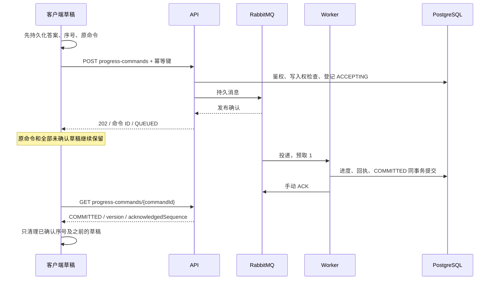

# 答题同步与系统监控

应用与合同基线为 v1.0。管理端“活跃度监控”负责用户人数、在线账号、趋势和排行榜；“系统监控”负责队列、接口及后台任务。实际验证范围见[验收记录](sync-monitoring-verification.md)。

## 在线与活跃

学生在登录成功、应用进入前台时立即上报，前台每 60 秒一次，退后台停止。`session_presence` 保存独立的前台心跳；后台进度同步产生学习活动，不更新前台心跳。

在线判定由数据库只读函数 `monitoring_online_at(sample_time)` 统一执行：最近 120 秒心跳、账号启用、会话有效且未撤销、凭据版本匹配。多人多端按用户 ID 去重。当前在线卡与列表使用相同函数，各自返回采样时间。

点击“当前在线”打开抽屉，沿用学院、专业、当前年级、客户端筛选，支持账号／昵称搜索，每页默认 20 条。每行展示账号、昵称、院系年级、会话数、客户端及最后心跳；昵称进入已有用户详情。失败保留上次结果并提示重试。

DAU、WAU、MAU 分别按北京时间当天、含今天的 7 天、30 天去重。每日活跃由后台消费业务事件更新，使用事件发生时间；只浏览的前台学生也计入。院系归属使用用户当前资料，游客和管理员不计入学生在线及活跃。

## 进度传递与客户端确认

同一练习最多一个未完成命令；不同练习可以并行。客户端每 5 秒合并有变化的进度，无变化不上传，切后台、离开、交卷及接管立即尝试。全局并发上限仍为 4，后台草稿占用最多 1 个槽位。接收 `202` 后每秒查询当前命令回执；网络故障按既有带抖动指数退避处理，最长 60 秒，限流遵守服务端等待时间。

页面区分“本机已保存”“服务器处理中”“服务器已保存”和本机存储失败。存储失败不会显示保存成功；重试先重新持久化当前状态。上传期间新增答案保持更高序号，旧回执不会覆盖新版本。杀进程后仍使用原命令正文、幂等键和序号续查。游客练习只使用本机记录。

`progress-ack` 仍表示成功响应已经落库，内部进入同一消息链路，最多等待 10 秒；等待超时返回 `503 SYNC_PENDING`，调用方使用原键重试。创建、正式交卷、取消、简答自评和写入权接管仍执行业务事务。交卷、取消、交出写入权遇到未完成命令返回 `409 SYNC_PENDING`，客户端等待确认后重试。

## 队列、状态与恢复

三条队列均为 durable quorum queue，消息持久化，发布确认超时 5 秒；消费者 4 个、每个预取 1 条，数据库提交后手动 ACK。

| 状态 | 含义 | 客户端处理 |
| --- | --- | --- |
| `ACCEPTING` | 命令已登记，发布尚未获确认 | 保留原请求，重试发布 |
| `QUEUED` | 已获得发布确认 | 保留草稿并查询回执 |
| `RETRYING` | 处理遇到暂时错误 | 等待后台重试 |
| `COMMITTED` | 进度与回执已提交 | 校验确认序号和版本后清理对应草稿 |
| `REJECTED` | 身份、凭证、版本或业务冲突 | 暂停自动重试，保留草稿，处理身份或冲突 |
| `DEAD_LETTER` | 技术失败达到上限 | 保留草稿，等待管理员恢复 |

`qanda.sync.progress` 等待消费；`qanda.sync.retry` 使用消息 TTL 和可靠死信转发返回进度队列；`qanda.sync.dead` 保存需要处理的失败消息。可记录的技术失败累计 8 次后进入死信，退避 1、2、4…秒，最大 60 秒。数据库等基础设施故障导致无法记录失败时，保留消息并退避重投，由应用恢复后继续处理；进度队列关闭 broker 自动投递次数上限，避免数据库命令仍在等待而消息已经被 broker 独自移出。

发布确认丢失可能产生重复消息，提交后 ACK 丢失也会重投。命令摘要、幂等回执、写入凭证与业务版本共同保证一次业务效果。入队前会访问数据库完成鉴权与登记，答案写入在消费阶段进行。

管理端先查看死信队首的命令 ID、练习 ID 和失败原因，再确认处理。后端重新校验原正文摘要并确认发布后 ACK 死信；同一处理意图使用原幂等键，操作进入审计。已有最终回执的重复死信只清理消息。格式或归属异常的消息保留在队列，需要人工检查；管理端不展示消息中的答案正文。

## 指标与 SSE

| 指标 | 来源和口径 |
| --- | --- |
| 当前排队 | RabbitMQ 进度队列 `messages_ready` |
| 正在处理 | 进度队列 `messages_unacked` |
| 平均生产／消费速率 | 进度队列最近 60 秒发布／ACK 计数器的 `rate`，单位条/秒，包含重投；Prometheus 按采样间隔估计窗口增量 |
| 成功落库速率 | 最近 60 秒首次进入 `COMMITTED` 的唯一命令数 ÷ 60 |
| 重试／死信 | 重试、死信队列各自消息数 |
| 平均／p95 同步延迟 | 最近 60 秒完成命令，从服务端登记至事务提交的耗时，单位毫秒 |
| 接口健康 | 核心 API 的请求/秒、5xx/秒、p95 秒数，按方法和规范化路由聚合 |
| 后台任务 | 消费者数、待投影活跃事件数、未完成邮件数 |

一条命令可以包含多题。离线且未上传的草稿不计入服务端排队量。四张用户人数卡、接口请求数与同步消息数分别表达不同对象。

服务连接状态来自 Prometheus 的 `up`，表示相应指标端点能否采集；消费者数、任务积压和接口错误率分别展示实际工作状态。

monitor 每 5 秒统一采样并缓存，SSE 连接建立立即发送最新快照，后续每 5 秒推送。事件为 `sync-health`，包含 `sampledAt`、`checkedAt`、`windowSeconds=60`、`status`、`reason` 和 `metrics`；连接空闲时发送 15 秒保活。每条连接 15 秒重新检查管理员权限，失效发送 `auth-expired` 并关闭。

状态 `SAMPLING` 表示样本不足，`RESET` 表示计数器重置，二者的速率留空；`STALE`／`UNAVAILABLE` 表示采集失败或没有成功数据。RabbitMQ 抓取数据超过 15 秒也视为过期。失败保留最后成功的值与采样时间。

管理端使用携带 Bearer 认证头的流式 fetch，支持分片、多行事件、CRLF、权限失效和断流；25 秒无字节会重连，异常按抖动退避，最长 30 秒，遵守 `Retry-After`。切页、隐藏和退出时取消订阅。每个 SSE 客户端最多缓存最新一条快照，最多 64 个连接，使用独立虚拟线程写出。

gateway 对监控路由关闭 `proxy_buffering` 和缓存，读取超时 45 秒。SSE 只传监控快照，答题正文继续经认证的进度接口传递。

## 接口

| 方法与路径（省略 `/api/v1`） | 权限 | 结果 |
| --- | --- | --- |
| `POST /practice/sessions/{id}/progress-commands` | 练习所属学生 | `202 ProgressCommandView` |
| `GET /practice/sessions/{id}/progress-commands/{commandId}` | 练习所属学生 | 状态、落库回执或失败原因 |
| `PUT /practice/sessions/{id}/progress-ack` | 练习所属学生 | 成功即已落库，等待超时使用原键重试 |
| `GET /admin/statistics/online-users` | 平台管理员 | 分页账号与采样时间 |
| `GET /admin/monitoring/sync/stream` | 平台管理员 | `text/event-stream` |
| `GET /admin/monitoring/health` | 平台管理员 | 模块、接口及后台任务摘要 |
| `GET /admin/sync/dead-letters/head` | 平台管理员 | 队首元数据，空队列 `item=null` |
| `POST /admin/sync/dead-letters/{commandId}/replay` | 平台管理员 | 幂等、审计的恢复处理 |

## 运行与数据边界

Compose 启动 gateway、api、worker、monitor、RabbitMQ、Prometheus、PostgreSQL 和 Mailpit。RabbitMQ 有独立持久卷，Prometheus 默认保留 15 天；单节点 quorum queue 提供持久性，但不能抵御整个节点或卷损坏。

全新隔离数据库初始化执行 `schema.sql` 与 `monitoring-permissions.sql`。已有开发库保持原状，应用的结构检查会明确阻止不匹配的库启动；本轮没有对已有库清空、迁移或备份。运行这份结构应使用独立数据库和持久卷，现有库的采用方式需要另行决定。

首次 `backend.mjs init` 生成私有 RabbitMQ 密码；已有私有配置需要补充 `BACKEND_RABBIT_PASSWORD`。凭据只放在忽略的配置或仓库外环境文件，管理服务端口留在内部网络。完整运行命令见[后端 README](../apps/api/README.md)。

参考：[RabbitMQ 发布与消费确认](https://www.rabbitmq.com/docs/confirms)、[RabbitMQ Prometheus 指标](https://www.rabbitmq.com/docs/prometheus)、[Spring Boot 指标](https://docs.spring.io/spring-boot/3.5/reference/actuator/metrics.html)、[SSE 标准](https://html.spec.whatwg.org/multipage/server-sent-events.html)。
